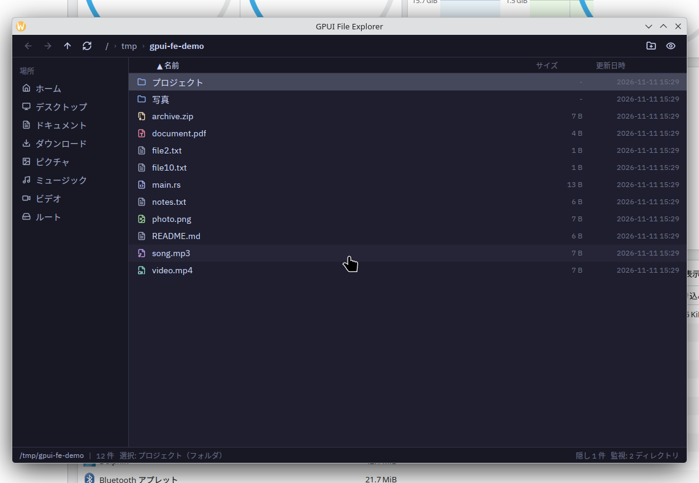

<!-- SPDX-License-Identifier: AGPL-3.0-or-later -->

# GPUI File Explorer — デスクトップ試作

Rust + [GPUI](https://github.com/zed-industries/zed/tree/main/crates/gpui) 系スタック
（`gpui-kit` 0.9.1 = GPUI snapshot + GPUI Component + Lucide assets）で作った
ファイルエクスプローラの**試作**です。まず Linux / KDE Plasma / Wayland で動くことを
目標にしつつ、コードはクロスプラットフォーム設計（`std::fs` + `dirs` + `trash`）です。

ライセンス: **AGPL-3.0-or-later**（[LICENSE](LICENSE)、依存クレジットは [NOTICE.md](NOTICE.md)）。



## 検証環境

- Kubuntu 2026.04 / KDE Plasma 6 / Wayland（ネイティブ Wayland ウィンドウ）
- NVIDIA GTX 1660 SUPER / rustc 1.99.1 / cargo 1.99.1
- `gpui-kit 0.9.1` → `gpui-pre 0.3.12` + `gpui-pre-platform 0.3.12`（lib 名 `gpui`）

## ビルド

```bash
cd gpui-file-explorer   # リポジトリ直下
bash scripts/dev-setup.sh   # 初回のみ（下記「前提」を参照）
cd app
cargo build                 # 初回（依存込み）約 1m30s / 2回目以降 約2s / debug バイナリ 約 165MiB
cargo test                  # 461 tests（データ層 + 監視）
```

リポジトリ直下から全体をビルドする場合:

```bash
bash scripts/dev-setup.sh
cargo build --manifest-path app/Cargo.toml
```

### 前提: `libxkbcommon-x11` のリンク回避（Linux で `-dev` が無いホスト）

`gpui-kit` は `gpui-pre-platform` の `x11` / `wayland` feature を固定で有効にします。
`gpui-pre-linux` は `-lxkbcommon-x11` を要求しますが、Ubuntu/Kubuntu では実行時
ライブラリ（`libxkbcommon-x11-0`）と開発用ファイル（`libxkbcommon-x11-dev`:
バージョン無し `libxkbcommon-x11.so` と pkg-config）が別パッケージです。
`-dev` が無いと最終リンクが失敗します。

推奨（システム全体、sudo 必要）:

```bash
sudo apt install libxkbcommon-x11-dev
```

sudo を使わない場合は同梱スクリプトで回避できます（システムは変更しません）:

```bash
bash scripts/dev-setup.sh   # app/native-libs/libxkbcommon-x11.so を作成
```

- スクリプトは `libxkbcommon-x11.so.0` を探して `app/native-libs/` に symlink します。
  pkg-config で開発用ファイルが見つかるホストでは、逆に symlink を削除します。
- `app/build.rs` が `native-libs/` を **絶対パスで** リンカ検索パスに追加します
  （CWD に依存しないため、どのディレクトリから `cargo build` しても動作します）。
- symlink が無いホストでは `build.rs` は何もしません（通常のリンクで通ります）。

## 実行

```bash
cd app
./target/debug/gpui-file-explorer              # 前回のディレクトリ or $HOME
./target/debug/gpui-file-explorer /usr/share   # 引数で開始ディレクトリを指定
./target/debug/gpui-file-explorer --help       # 使い方を表示して終了
./target/debug/gpui-file-explorer --version    # バージョンを表示して終了
```

### コマンドラインオプション

| オプション | 動作 |
|---|---|
| `ディレクトリ` | 開始ディレクトリを指定。存在しないパスやファイルを渡した場合は警告を出し、前回のディレクトリ（無ければ `$HOME`）へフォールバックします |
| `-V` / `--version` | バージョンを表示して終了（ウィンドウは開きません） |
| `-h` / `--help` | 使い方を表示して終了（ウィンドウは開きません） |
| `--` | 以降の引数をすべてパスとして扱います（`-` で始まる名前のフォルダや `--help` という名前も指定可能） |

ウィンドウは 1100x700（コンテンツ）、Wayland `app_id` / KWin `resourceClass` は
`gpui-file-explorer` です。閉じると終了します。

操作・エラーのログは `tracing` の構造化イベント（レベル・タイムスタンプ付き）
で stderr に出ます。既定は `info` レベルで、通常起動時は操作を行うまで
出力はありません。`RUST_LOG=debug` 等で詳細度を変更できます
（例: `RUST_LOG=debug ./target/debug/gpui-file-explorer`）。

## キーバインド

| キー | 動作 |
|---|---|
| `Up` / `Down` | 選択を上下に移動（選択が見えるようスクロール） |
| `Shift+Up/Down/Home/End` | 範囲選択（アンカーから拡張） |
| `Ctrl+クリック` / `Shift+クリック` | 個別トグル / 範囲選択 |
| `Ctrl+A` | 表示中の全項目を選択 |
| `Ctrl+Space` | フォーカス行の選択を切替（非連続選択） |
| `Ctrl+1` / `Ctrl+2` | 詳細リスト / アイコングリッド表示（ツールバーのボタンでも切替） |
| `Ctrl+F` | 検索バーを開く（ディレクトリ表示のみ）。`Enter` で再帰検索、`Esc` で閉じる。検索範囲を「現在のフォルダ / 開いているタブ / ブックマーク」から選択可能 |
| `Ctrl+Shift+F` | 検索バーの「名前」入力へフォーカス（取得済み結果を名前の部分一致で絞り込み） |
| `Ctrl+T` / `Ctrl+W` | タブを開く（現在のディレクトリ）/ アクティブタブを閉じる（最後の1枚は不可） |
| `Ctrl+Shift+T` | 最後に閉じたタブを復元（メモリ上のみ、再起動後は不可） |
| `Ctrl+D` | 現在のディレクトリをブックマークに追加 / 解除 |
| `Ctrl+L` | パスを直接入力して移動（`~` / 相対パス対応） |
| `Ctrl+Shift+L` | サイドバーのホームへ移動（他の場所はマウスのみ） |
| `Space` / `F3` | 選択ファイルのテキストプレビュー（読み取り専用） |
| `Ctrl+Z` / `Ctrl+Shift+Z` | 元に戻す / やり直す（**名前変更とゴミ箱のみ**） |
| `Ctrl+Shift+U` | 操作の履歴を表示 |
| `Ctrl+I` | 選択項目のプロパティ（読み取り専用） |
| `F1` | キーボードショートカット一覧（ヘルプ） |
| `Alt+T` | ターミナル起動コマンドを設定（`F4` で使用。空白で無効化、Enter で保存 / Esc でキャンセル） |
| `Alt+K` | キーマップを設定（`アクション名 コード` / `unbind アクション名`、Enter で保存 / Esc でキャンセル） |
| `Ctrl+,` | 設定を開く（5 タブ。Alt+K / Alt+T の個別ダイアログを包含・補完） |
| 設定ダイアログのキー | `Enter` で保存 / `Esc` でキャンセル。未保存変更があると破棄時に通知。上部の検索欄で設定項目を絞り込み（キー名 `Alt+K` 等でも検索可）。テーマ表示名は「ダーク / ライト / システム」 |
| 設定ダイアログのタブ | `Ctrl+Tab` / `Ctrl+Shift+Tab` で次のタブ / 前のタブへ移動（端で循環） |
| 設定の `Tab` / `Shift+Tab` | 検索欄 → 現在タブの入力欄 → キャンセル / 保存へフォーカス移動（循環） |
| `Ctrl+P` | クイックジャンプ（候補を絞り込み、Enter で移動・Esc でキャンセル） |
| `Ctrl+Tab` / `Ctrl+Shift+Tab` | 次のタブ / 前のタブ（循環） |
| `Ctrl+Shift+PageUp` / `Ctrl+Shift+PageDown` | アクティブタブを左 / 右へ移動 |
| `Home` / `End` | 先頭 / 末尾を選択 |
| `Enter` | 選択項目を開く（ディレクトリ→移動、ファイル→既定アプリ） |
| `Backspace` / `Alt+Up` / ↑ボタン | 親ディレクトリへ |
| `Alt+Left` / `Alt+Right` | 戻る / 進む（履歴） |
| `Ctrl+H` | 隠しファイル（`.` 始まり）の表示切替 |
| `Alt+Shift+T` | テーマをダーク → ライト → システム → ダークに切替（`theme_choice` に保存） |
| `ミドルクリック` | 行 / グリッドセルを新しいタブで開く（フォルダ行はそのフォルダ、それ以外は現在のディレクトリ） |
| `PageUp` / `PageDown` | 可視行数分の選択移動 |
| `Delete` | 選択項目をゴミ箱へ移動（確認ダイアログあり） |
| `R` / `Ctrl+Enter` | 選択項目を元の場所へ復元（ゴミ箱ビュー） |
| `Ctrl+R` / `F5` / ⟳ボタン | 再読み込み |
| `F2` | 選択項目の名前を変更（ダイアログ） |
| `Ctrl+Shift+N` | 新規フォルダ作成 |
| `Ctrl+C` / `Ctrl+X` | 選択項目をコピー / 切り取り（アプリ内クリップボード） |
| `Ctrl+Shift+C` | フォーカス行のパスをコピー |
| `Ctrl+V` | コピー/切り取り項目を現在のフォルダへ貼り付け（上書きしません） |
| `Esc` | 実行中のコピー/移動をキャンセル |
| `Ctrl+Q` | 終了 |
| ダブルクリック | ディレクトリ移動 / ファイルを既定アプリで開く |
| 右クリック | コンテキストメニュー（開く / ファイルマネージャで表示 / パスをコピー / ゴミ箱へ移動 / 新規フォルダ） |
| ヘッダクリック | 名前 / サイズ / 更新日時でソート（同一列で昇順⇔降順） |
| サイドバー / パンくずクリック | その場所へ移動 |

**設定ダイアログの Tab 巡回**: `Tab` / `Shift+Tab` は検索欄 → 表示中の
タブのテキスト入力（ショートカット / ターミナル）→ キャンセル / 保存ボタン
の順に循環します。gpui-component 0.9.1 には汎用の `TabIndex` が無いため、
ラジオボタン・スイッチ・タブバーはこの巡回には含まれません。

### キーマップの上書き（設定 UI / settings.json）

キーバインドは出荷時の既定値に加えて上書きできます。設定 UI を使う場合は
`Alt+K` でダイアログを開き、**`アクション名 コード`**（空白区切り）を入力します。
入力欄には `open_preview ` が事前入力されています。Enter で確定すると
`settings.json` に保存され、その場で新しいキーマップが有効になります。
Esc でキャンセルすると保存せずに閉じます。

上書きを解除して既定のキーバインドに戻すには、同じダイアログで
**`unbind アクション名`**（例: `unbind open_preview`）を入力して Enter を押します。
保存済みの上書きが削除され、そのアクションは出荷時の既定バインドに戻ります。

```text
open_preview ctrl+shift+p
unbind open_preview
```

GPUI のキー入力イベントはグローバルに配信されるため、ダイアログで生の
キーストロークを記録する方式は採っていません。代わりにテキスト入力を使い、
アクション名は `KeyAction` の serde 名（snake_case）、コードは既存の
`parse_chord` で検証します。

設定画面（`Ctrl+,` → 「ショートカット」タブ）の入力欄は構文が異なります。
**`action=chord;`** を **`;` 区切り**で記述します（例:
`open_preview=ctrl+shift+p;quit=ctrl+q;`）。保存すると入力欄の内容が
上書き一覧を**すべて置き換え**ます。削除したい場合は入力欄から該当項目を
消して保存してください（`unbind` 構文はありません。`Alt+K` ダイアログは
`action chord` / `unbind action` で 1 件ずつ登録・解除します）。

手編集する場合はアプリを終了した状態で次のように書きます（起動時に読み込み、
終了時の保存で上書きされます）。

```json
{
  "version": 1,
  "keymap": [
    ["open_preview", "ctrl+shift+p"],
    ["go_back", "alt+left"],
    ["quit", "ctrl+q"]
  ]
}
```

- 形式は `[アクション名, コード]` の組です。アクション名には `KeyAction` の
  snake_case 名（`open_preview` / `fuzzy_jump` / `toggle_hidden` など）を指定します。
- コードは `+` で区切った修飾キー（`ctrl` / `shift` / `alt`）とキー名です。
  修飾キーの順番は任意で大小文字は無視し、キー名は最後に置きます。キー名は
  GPUI のキーストローク名（小文字の `p` / `pageup` / `f4` / `left` など）として
  解釈されます。例: `ctrl+shift+p`、`shift+alt+ctrl+pageup`、`f4`。
- `escape` / `f1` はダイアログ操作用の予約キーで、上書きできません。
  UI ではエラーを表示し、手編集時は読み込み時に破棄されます。
- 存在しないアクション名や不正なコードは無視され、既定のキーマップが残ります。
  **同じアクション名は最後に登録したものが優先されます**（UI は既存の
  エントリを置換します。手編集で重複させた場合は最初の 1 件が有効です）。
  最大 64 件まで保持されます。
- UI での変更は即時に反映され再起動後も復元されます。手編集の反映は次回
  起動時です。手編集で既定値に戻す場合は `keymap` を `[]` にするか削除します。
  UI では `unbind アクション名` で個別に既定バインドへ戻せます。

### テーマ設定

`settings.json` の `theme_choice` でテーマの選択を指定します（`Alt+Shift+T`
で切り替えると同じ値が保存されます）。

```json
{
  "version": 1,
  "theme_choice": "system"
}
```

- 値は `"dark"` / `"light"` / `"system"` の 3 種類です。省略時（旧バージョン
  の設定ファイルを含む）は `"dark"` として扱われます。
- `Alt+Shift+T` は **Dark → Light → System → Dark** の順に循環します。
- `"system"` を選ぶと、GPUI が観測するウィンドウの外観（OS のライト／
  ダーク設定）から実効テーマを解決します。OS 側の設定が変わると自動的に
  追従します（アプリ側のパレットとコンポーネントテーマの両方に適用されます）。
- 旧形式の `"theme"` キー（`"dark"` / `"light"` / `"system"`）は読み込み時に
  `theme_choice` へ引き継がれます。保存時は `theme_choice` が優先され、
  `theme` は解決済みのモード（`"dark"` / `"light"`）を互換用に保持します。

## 実装済み機能（P0）

- [x] ツールバー: 戻る・進む・親へ・更新、クリック可能なパンくず、サイドバー
      （ホーム / デスクトップ / ドキュメント / ダウンロード / ピクチャ /
      ミュージック / ビデオ / ルート / ゴミ箱）、「最近」と「ドライブ」一覧。場所の解決と存在確認は**起動時 + 再読込時のみ**
      行い、描画パスでは `user-dirs.dirs` の再読や stat をしない（毎フレーム I/O 禁止）
- [x] 仮想化詳細リスト（`uniform_list`）: アイコン / 名前（省略表示）/
      サイズ / 更新日時。ディレクトリ先頭、自然順ソート
      （`file2` < `file10`、大文字小文字を無視）
- [x] ステータスバー: 現在パス / 件数 / 選択項目 / 読み込み・エラー /
      非表示の隠しファイル数 / 監視状態
- [x] 非同期ディレクトリ読み込み（`cx.background_spawn`）。UI スレッドで
      `read_dir` をしない。ジェネレーション番号 + `Task` drop で古い結果を破棄。
      loading / error / empty（空フォルダ・隠しファイルのみ）表示
- [x] ナビゲーション: サイドバー、ダブルクリック、Enter、Backspace、↑、
      Alt+Left/Right、パンくず、browser 風の戻る/進む履歴
- [x] 選択: クリック / キーボード、`scroll_to_item(Nearest)` で追従、
      ステータスに選択内容表示
- [x] ファイルを開く: ダブルクリック / Enter → `cx.open_with_system`
- [x] コンテキストメニュー（右クリック位置に表示、外側クリック/Esc で閉じる）:
      既定アプリで開く / ファイルマネージャで表示（`cx.reveal_path`）/
      パスをコピー（`ClipboardItem`）/ ゴミ箱へ移動（ネイティブ確認ダイアログ後、
      `trash` クレート）/ 新規フォルダ。メニューは**行の `PathBuf` を捕捉**し、
      クリック時にパスで対象を再解決する（表示中に監視更新で並び替わっても
      別エントリへ誤操作しない）
- [x] ファイル監視: `notify` 8.2 + `notify-debouncer-full` 0.7、
      カレント + 親を非再帰 watch、400ms デバウンス、変更時に自動リフレッシュ。
      10 秒ごとの照合（reconcile）で取りこぼしを回復。自分の trash/mkdir 後は
      1.5 秒間イベントを抑制して自己ループを防止
- [x] 新規フォルダ作成は background executor で実行（`新しいフォルダ` の
      連番プローブ + `create_dir` を UI スレッドで行わない）
- [x] 設定の永続化: `~/.config/gpui-file-explorer/settings.json`
      （最終ディレクトリ・ソートキー・昇順/降順・隠しファイル表示）。
      起動時ロード、変更時保存。壊れた JSON は `settings.json.broken-<epochナノ秒>-<PID>` に
      退避して既定値で起動（起動失敗にしない）。存在しない `last_dir` は無視
- [x] AGPL-3.0-or-later（LICENSE）、NOTICE、各ソースに SPDX ヘッダ

## P1（実装済み）

- [x] **安全なファイル操作エンジン**（`src/ops.rs`、UI 接続済み・ユニットテストあり）
  - 上書き禁止が既定（`ConflictPolicy::{Fail, Skip, Rename}`。`Overwrite` は意図的に無し）
  - コピーは `.partial-*` へ書き、完了後に O_EXCL 予約 + rename で配置（部分ファイルを残さない）
  - シンボリックリンクはリンクとしてコピーし、削除時は**絶対に辿らない**（`symlink_metadata`）
  - 移動は同一 FS なら `rename`、`EXDEV` は「コピー成功後にのみ元を削除」
  - キャンセル（`CancelFlag`）で部分ファイルを掃除。ディレクトリを自身の配下へコピー/移動する操作を拒否
  - リネームは上書き拒否 + 大小文字のみ変更を 2 段階 rename で対応
  - 47 件のユニットテスト（上書き拒否 / Skip / Rename / 再帰コピー / symlink / キャンセル / /dev/shm による実クロスデバイス移動フォールバック / 安全削除）
- [x] **UI 接続（コピー/切り取り/貼り付け）**: `Ctrl+C` / `Ctrl+X` / `Ctrl+V` と右クリックメニュー。
  貼り付けは常に `ConflictPolicy::Rename`（既存ファイルを上書きしない）、実行は background executor、
  `Esc` で協調キャンセル。完了後に件数/サイズをステータス表示し、貼り付け先を選択して再読込
- [x] **リネームダイアログ（F2 / 右クリック「名前変更」）**: 入力欄に現在名をプリフィル、
  Enter で確定 / Esc・キャンセルで中止。名前検証と既存先チェックを行い、
  実際の rename は background executor。失敗時はダイアログにエラーを表示し、
  元のファイルは変更しません。成功時は watcher を抑制して再読込し、新しい名前を選択
- [x] **コピー/移動の進捗表示**: エンジンが 64 KiB チャンクごとに累積バイトを通知し、
  `async_channel` 経由で前景へ転送。ステータスバーに「コピー中… 12.3 MB（Esc でキャンセル）」を
  約 80 ms スロットルで表示（操作完了後は最終結果で上書き）
- [x] **複数選択**: Ctrl+クリック（トグル）/ Shift+クリック・Shift+矢印（範囲）/ Ctrl+A。
  ステータスに「N 件選択」を表示。選択はパスをキーに保持し、再読込・ソート後も維持
- [x] **バッチ操作**: コピー/切り取り/貼り付け・ゴミ箱移動を選択全体に適用。
  ゴミ箱は件数付き確認ダイアログ、貼り付けは 1 件ずつ `Rename` ポリシーで処理し、
  一部失敗時は成功分と失敗件数を表示
- [x] **ゴミ箱ビュー（一覧・復元）**: サイドバーの「ゴミ箱」でシステムのゴミ箱を仮想一覧表示。
  削除日時の新しい順、選択/複数選択に対応。`Enter` / ダブルクリック / 右クリック
  「元の場所へ復元」で復元（衝突時はエラー表示、項目はゴミ箱に残る）。
  **完全削除は提供しません**（`Delete` は「未対応」表示）
- [x] **視覚的な進捗バー**: コピー/移動の前に総バイト数を background で事前計算し、
  ステータスバーにバー + パーセントを表示（例: `コピー中… 35.0 MB / 100.0 MB`）。
  進捗は 64 KiB チャンクごとに `async_channel` で前景へ送り、約 80 ms でスロットル
- [x] **アイコングリッド表示**: ツールバーの切替 / `Ctrl+2`。`uniform_list` の「1 行 = N セル」方式で
  仮想化し、ウィンドウ幅から列数を自動計算（1 セル 108px 基準）。設定に永続化（`"view": "icons"`）
- [x] **再帰検索（ファイル名 / 複数ルート）**: `Ctrl+F` → 検索バー → `Enter`。`std::fs` ベースの自作 walker で
  選択した検索範囲を走査（新しい依存なし）。symlink ディレクトリは**辿らない**、
  隠し項目は既定で除外（Ctrl+H の表示設定に追従）、単一ルートは最大 2000 件 / 深さ 24、
  複数ルートは全体 2000 件を上限に統合（同一パスは重複排除）、`Esc` でキャンセル・終了。
  結果はパス順で表示
  - **検索範囲**: 「現在のフォルダ / 開いているタブ / ブックマーク」を切替可能。
    タブ・ブックマークは存在するディレクトリのみ対象
  - **絞り込み**: 「すべて / ファイル / フォルダ」の種別ボタン、拡張子入力（例 `rs`）、
    名前入力（`Ctrl+Shift+F` でフォーカス）の3種類。
    すべて再検索せず、取得済みの結果をクライアント側で絞り込みます
  - **検索履歴**: 検索語を最大 10 件まで設定に保存。検索欄が空のとき
    「最近の検索:」チップとして表示され、クリックで再利用できます
  - **内容検索**: 「名前 / 内容」ボタンでモード切替。内容検索はファイル中身を
    大小文字無視で検索し、最初に一致した行番号を表示（例 `src/main.rs:12`）。
    1 ファイル 1 MiB まで・NUL を含むバイナリは除外・symlink は読まない・
    最大 500 件 / 深さ 24・`Esc` でキャンセル
  - [x] **タブ**: 複数ディレクトリをタブで保持（`Ctrl+T` / `Ctrl+W` / `Ctrl+Tab`、
  タブバーのクリック・「+」・「×」）。タブごとに**カレントディレクトリと戻る/進む履歴**を保持し、
  切替時に保存/復元。最後の1枚は閉じられません。`Ctrl+Shift+PageUp/PageDown` で並べ替え。
  **タブ構成・アクティブタブ・各タブの戻る/進む履歴は設定に保存され、
  再起動時に復元**されます（存在しないディレクトリは除外）
- [x] **ドラッグ&ドロップ**:
  - OS（Dolphin 等）からウィンドウへファイル/フォルダをドロップすると**コピー**。
    フォルダ行/セルへドロップした場合は**そのフォルダへ**、それ以外はカレントディレクトリへ。
    常にコピー（移動しない）・`ConflictPolicy::Rename` で**上書きしない**・`Esc` でキャンセル。
    symlink フォルダはドロップ先にできません（安全側）
  - 行/セルを OS へドラッグすると外部ファイルドラッグとして渡す（選択全体を対象、ディレクトリ情報付き）
  - ゴミ箱・検索ビューでのドロップ、操作実行中のドロップは拒否
- [x] **安全側の明文化**: `#![forbid(unsafe_code)]` を app 本体と `build.rs` に適用。
  ツールバーの詳細/グリッド切替ボタンにアクティブ表示を追加
- [x] **元に戻す / やり直す（Ctrl+Z / Ctrl+Shift+Z）**: 安全に戻せる操作だけを対象にした
  アンドゥスタック（最大 20 件、再起動で消えます）
  - **名前変更**: 変更後の名前を元の名前に戻します（元の名前が既に存在する場合は拒否）
  - **ゴミ箱**: **ゴミ箱アイテム ID** で特定して復元します（同じパスの別アイテムを誤って戻さない）
  - コピー/移動は対象外です。戻すにはユーザーのデータを削除する必要があり、
    「勝手に削除しない」原則に反するため、ステータスに理由を表示して拒否します
  - ツールバーのボタン（履歴が無いときは無効）とステータスバーに件数を表示
- [x] **キーボードヘルプ（F1）**: ショートカット一覧をオーバーレイ表示（スクロール可、`F1`/`Esc`/閉じるで終了）
- [x] **空状態・ローディング表示**: 読み込み中 / 空ディレクトリ / ゴミ箱が空 / 検索0件 /
  絞り込みで全件除外 / 隠しファイル全件、を中央にメッセージ + 補足ヒントで表示
  （例: 空フォルダでは「ここにファイルをドロップするとコピーできます」）
- [x] **プロパティ表示**: `Ctrl+I` / 右クリック「プロパティ」。名前・パス・種類・サイズ・更新日時・
  パーミッション（Unix）・symlink リンク先を**読み取り専用**で表示。`Esc` / 背景クリック / 閉じるで終了
  - ディレクトリは「サイズを計算」で**再帰サイズをバックグラウンド計算**（ファイル数・フォルダ数付き、
    symlink 非追跡、ダイアログを閉じるとキャンセル）
- [x] **テキスト/画像プレビュー（Space / F3）**: 選択ファイルを読み取り専用オーバーレイで表示。
  等幅フォント・スクロール対応、`Space` / `F3` / `Esc` / 閉じるで終了
  - テキスト: 最大 256 KiB（超過分は「先頭のみ」表示）、読み込んだ範囲に NUL を含むバイナリは拒否
  - 画像: PNG/JPEG/WebP/GIF/SVG/BMP/TIFF/ICO/PNM。**先頭バイト（magic number）で実際の形式を判定**し、
    拡張子と中身が食い違う場合は中身を優先して描画（不一致で固まらない）。最大 8 MiB
  - どちらも **symlink とディレクトリは拒否**。読み取り失敗・判定不能は赤文字でエラー表示
- [x] **パス直接入力（Ctrl+L）**: 現在パスをプリフィルした入力バーを開き、Enter で移動。
  `~` / `~/...` はホームへ展開、相対パスは現在ディレクトリ基準。無効なパスはバー内に赤字表示
- [x] **ブックマーク**: `Ctrl+D` で現在のディレクトリを登録/解除（最大 50 件、設定に保存）。
  サイドバー「ブックマーク」からワンクリックで移動。存在しないものは再読込時に除去
- [x] **最近使った場所**: 移動したディレクトリを最大 10 件まで設定に保存し、サイドバー「最近」に表示。
  クリックで移動。存在しないディレクトリは再読込時に除去（描画パスでは stat しない）
- [x] **ボリューム（ドライブ）一覧**: サイドバーに「ドライブ」セクション。Linux は
  `/proc/mounts` を解析（pseudo FS・システムマウントを除外、重複排除、octal escape 対応）。
  再読込時に再取得。クリックで移動

## 今後の候補

- 検索結果のソース表示（複数ルート検索時の由来ラベル強化）
- OS のファイルクリップボード連携（GPUI 側未実装）
- 画像サムネイルの抽出（ファイル種別アイコンは Breeze のシステムアイコンを使用し、
  見つからない場合は Lucide へフォールバック済み）
- 右クリックメニューの「空き領域」版（現状は行の右クリックと
  ツールバーの「新規フォルダ」ボタン。理由は既知の制限を参照）

## アーキテクチャ

| ファイル | 役割 |
|---|---|
| `src/main.rs` | ウィンドウ / UI レイアウト（ツールバー・サイドバー・リスト・ステータスバー）/ キー・マウス操作 / コンテキストメニュー / 非同期ロード / 設定・履歴の結線 |
| `src/model.rs` | `Entry` と `read_dir`、フィルタ、自然順ソート、人間向けサイズ/日時、選択計算、パンくず、fingerprint（GPUI 非依存 = テスト容易） |
| `src/error.rs` | `AppError`（`FsError` / `OpError` の共通実装）。`model.rs` のサブモジュール |
| `src/history.rs` | 戻る/進む履歴スタック |
| `src/tabs.rs` | タブごとのカレントディレクトリと戻る/進む履歴（GPUI 非依存） |
| `src/settings.rs` | serde_json 永続化（アトミック書き込み） |
| `src/settings_ui.rs` | 設定オーバーレイの描画と操作意図の通知。配色は `SettingsUiPalette` 経由 |
| `src/icons.rs` | 拡張子 → Lucide アイコン分類（GPUI 非依存）・システムアイコン欠落時のフォールバック |
| `src/system_icons.rs` | freedesktop アイコン（Breeze 等）のパス解決とサイズ別キャッシュ |
| `src/watcher.rs` | debounce 付き OS ファイル監視（カレント + 親、非再帰） |
| `src/ops.rs` | 安全なコピー/移動/リネーム/ゴミ箱の操作エンジン |
| `src/search.rs` | 名前・内容検索、複数ルート統合、後段フィルタ |
| `src/preview.rs` | テキスト/画像プレビューの読み取りと形式判定 |
| `src/mounts.rs` | `/proc/mounts` 解析（Linux）とボリューム一覧 |
| `src/trash_view.rs` | ゴミ箱内一覧と ID 指定の復元 |
| `src/undo.rs` | 名前変更・ゴミ箱の undo/redo スタック |
| `src/strings.rs` | UI 文言の集約（ヘルプ・空状態・ステータス） |

設計方針:

- **データ層（model/history/settings/icons の分類）は GPUI 非依存**にして
  ヘッドレステスト。UI 層だけが GPUI に依存。
- 一覧は「全件（`all_entries`）」と「表示用（`entries`）」を分離し、
  隠しファイル切替・ソート切替は再読み込みなしで再構築。
- 監視スレッドは UI に触れず、`async-channel` でフォアグラウンドの
  GPUI タスクに通知（GPUI の Entity はスレッド非依存のため）。

## テスト

```bash
cargo test
# running 461 tests ... test result: ok. 461 passed; 0 failed
```

カバレッジ: ディレクトリ読み込み（ディレクトリ先頭・メタデータ・エラー）、
自然順/大文字小文字無視ソート、サイズ/更新日時ソートと方向、
隠しファイルフィルタ、選択クランプ/移動、履歴の戻る/進む/分岐、
設定の roundtrip・壊れた JSON・部分 JSON・存在しないディレクトリ、
fingerprint の変化検出、パンくず生成、一意な新規フォルダ名、
アイコン分類（拡張子・大文字小文字・ドットファイル）、
実 inotify でのファイル作成イベント検知。

## 実行検証記録（2026-11-11, このマシン。テスト数は 2026-11-21 更新）

- `cargo build`: 警告 0 / `cargo test`: 461 passed
  （初回実機検証時は 35 件（M-1/2/3 修正後 36 件））
- 起動: stderr 0 行（EGL/Vulkan/Wayland エラーなし）
- KWin D-Bus（Wayland ネイティブであることの確認）:

```text
$ qdbus6 --literal org.kde.KWin /WindowsRunner org.kde.krunner1.Match "GPUI File Explorer"
"0_{...}", "GPUI File Explorer", "wayland", ...
$ qdbus6 --literal org.kde.KWin /KWin getWindowInfo "{...}"
caption="GPUI File Explorer", resourceClass="gpui-file-explorer",
width=1100, height=728 (コンテンツ 1100x700 + タイトルバー),
minimized=false, fullscreen=false, type=0
```

- スクリーンショット: `screenshot/window-crop.png`（XDG Desktop Portal で取得し
  ウィンドウ領域を crop）
- **監視の実証**: 起動したまま bash から `from-bash-while-running.txt` を作成 →
  約2秒後に一覧へ自動反映（件数 12→13、行が追加）。
  `screenshot/watcher-refresh-crop.png` が「反映後」。stderr 0 行のまま。
- **設定の永続化の実証**: 引数ありで起動して終了 →
  `~/.config/gpui-file-explorer/settings.json` に下記（DESIGN.md §8.1 のスキーマ）が
  保存され、引数なしの再起動でそのディレクトリが復元されることを確認
  （`screenshot/settings-restore-crop.png` のパンくずが
  `/ › tmp › gpui-fe-persist-demo`）。

```json
{
  "version": 1,
  "last_dir": "/tmp/gpui-fe-schema-check",
  "sort": { "key": "name", "dir": "asc", "dirs_first": true },
  "show_hidden": false,
  "view": "details"
}
```
- 終了: `kill -TERM` 後、KWin のウィンドウ一覧から消えること（`{}`）を確認。
  デスクトップ設定・システムには一切変更なし。検証用の一時ディレクトリ・
  ポータル保存スクショは削除済みで、`~/.config/gpui-file-explorer/settings.json`
  も最終確認後に削除しています（Lead の独立検証でも残存なしを確認済み）。

## 配布（Linux DEB）

リポジトリ直下のスクリプトで DEB を作成できます（root 不要、ホストへはインストールしません）:

```bash
bash packaging/linux/build-deb.sh
# 出力: packaging/linux/build/gpui-file-explorer_<version>-1_<arch>.deb
```

`.desktop`（`StartupWMClass=gpui-file-explorer`）、hicolor アイコン、ドキュメントを同梱します。
依存パッケージはビルド時に `ldd` + `dpkg -S` から生成します。

## 既知の制限

- **100,000 件のメモリ目標（200 MB 以下）は未達**: 実 GUI プロセスを
  release ビルドで起動して計測した VmRSS は 329,712 KiB（約 322 MiB）で、
  DESIGN §10.5 の目標を約 1.6 倍超過した。空ディレクトリのベースラインは
  204,792 KiB（約 200 MiB）で、100k 件の実コストは 124,920 KiB
  （データ層約 60 MiB + GUI 側約 63 MiB）。目標自体が P2（先送り）のため、
  本版では改善していない。実測手順と生データは
  `notes/perf-baseline.md` を参照。
- **ファイルを開く / リビールの失敗は検知できません**: 使用 API
  （`cx.open_with_system` / `cx.reveal_path`）は戻り値を持たないため、
  xdg-open 等が失敗しても「開きました」「表示しました」という成功文言のままです
  （AC-9）。GPUI 側の API 制約のため未対応で、将来的には D-Bus /
  プロセス終了コード監視などの導入が必要です。
- 設定の保存は tmp + rename + `sync_all()` です。ディレクトリの fsync は
  未実施のため、電源断時の完全な耐性は保証外です。
  `version` は現状 1 固定です。未知の version（新しいビルドが書いた設定）
  は値を保持したまま**読み取り専用**として扱い、保存を no-op にして
  未知フィールドの消失を防ぎます。
- **キーを生で記録するキャプチャ UI は未実装**です（GPUI の `key_down` が
  グローバルなため）。代わりに **`Alt+K` のテキスト入力ダイアログ**を実装し、
  `アクション名 コード` を入力して `settings.json` の `keymap` に保存・即時反映
  しています（上の「キーマップの上書き（設定 UI / settings.json）」を参照）。
  `KeyMap::rebind` は起動時に保存済みの上書きを適用するため本体からも呼ばれ、
  ダイアログからの登録でも同じ経路でテーブルを再構築します。
  `KeyMap::reset`（既定値へ戻すボタン）はデータ層のみで、本体からはまだ
  呼ばれていません。手編集で既定値に戻すには `keymap` を `[]` にするか削除してください。
  個別のバインドは `Alt+K` で `unbind アクション名` を入力すると既定へ戻せます。
  一方、**ターミナル起動コマンドの設定 UI は実装済み**です。`Alt+T` で
  ダイアログを開き、Enter で確定すると `settings.json` の `terminal_command`
  に保存されます（Esc でキャンセル、空白のみなら無効化）。`F4` はこの
  コマンドを使って選択フォルダでターミナルを開きます。
- 起動時 `canonicalize` / 各所の単発 `is_dir()`（起動・ナビゲーション時のみ）は
  同期実行です（影響はマイクロ秒級。DESIGN §4.4 の厳密適用は今後の改善候補）。
- `Window::prompt` のダイアログ表示中に別の prompt を開かない保証はありません
  （GPS の再入制約に依存。失敗時はキャンセル扱いで安全側）。
- `SortSpec.dirs_first` は将来互換のため保存していますが、P0 は常に
  ディレクトリ先頭固定です（`false` は無視）。
- **マウス/キーボード操作の E2E 検証は未実施**です。合成入力ツール
  （`wtype` / `xdotool` / `ydotool` の 3 つ）は `scripts/setup-e2e-input.sh` で
  sudo なしのユーザー空間へ**導入済み**です（展開先
  `~/.local/e2e-tools/bin`。利用には
  `export PATH="$HOME/.local/e2e-tools/bin:$PATH"` が必要）。
  しかし本機の KWin 制約（Wayland ネイティブは `zwp_virtual_keyboard_v1`
  非対応、XTEST は「Control input devices」ポータル許可待ち、
  `/dev/uinput` は root:root 0600）のため、Wayland ネイティブの本アプリへ
  入力が届きません。キーボード・右クリック・確認ダイアログのコードは
  コンパイル検証 + データ層のユニットテストのみで、実押下は未確認です
  （PoC と同じ環境制約）。手動確認する場合は
  `Ctrl+H` / `Alt+←` / 行の右クリック / ゴミ箱移動などをお試しください。
  セットアップ手順と `ldd` / スモークテストの実測結果は
  [../notes/e2e-input-probe.md](../notes/e2e-input-probe.md) を参照。
- 右クリックメニューは**行の上**でのみ開きます。仮想リストが空白領域まで
  占有するため、空き領域の右クリックメニューは未対応です
  （新規フォルダはツールバーのボタンでも作成できます）。
- 複数選択はクリック/キーボードのみ（ラバーバンド選択は未実装）。リネームは
  フォーカス行（最後にクリックした行）にのみ適用されます。
- バッチ貼り付けは 1 件ずつ順次処理します（部分失敗時は成功分を残し、失敗件数を表示）。
  進行中のバッチは Esc でキャンセルできますが、処理済みの項目は元に戻りません。
- コピー/移動は**アプリ内クリップボード**のみです。OS のファイルクリップボード
  （`text/uri-list`）連携は、GPUI 0.3.12 の Linux バックエンドがファイル一覧を
  読み書きしないため未対応です（調査: [../notes/os-file-clipboard-notes.md](../notes/os-file-clipboard-notes.md)）。
  パスをテキストとしてコピーする「パスをコピー」は利用できます。
  貼り付けは常に「別名で保存」（`ConflictPolicy::Rename`）で、上書き確認は出しません。
  進捗はステータスバーにバー + 累積/総バイトで表示します（約 80 ms 間隔）。
  総バイト数はコピー前の事前走査による**ベストエフォート**で、symlink は追跡せず、
  読めない項目は除外します（巨大ツリーでは事前走査に時間がかかります）。
  `Esc` で協調キャンセルできます。
- リネームの**実押下 E2E は未検証**です（合成入力ツールは導入済みだが KWin の入力制約で届かないため、詳細は冒頭の既知の制限を参照）。
  ダイアログ描画とエンジン（`ops::rename_entry`）は検証済みですが、入力→Enter→反映の
  一連の操作は手動確認をお願いします。UI 検証用に `GPUI_FE_DEBUG_RENAME=1` で起動すると
  最初の項目のリネームダイアログを開いた状態で表示できます（スクリーンショット用）。
  同様に `GPUI_FE_DEBUG_SELECT_ALL=1`（全選択）、`GPUI_FE_DEBUG_TRASH=1`（ゴミ箱ビュー）、
  `GPUI_FE_DEBUG_TRASH_RESTORE=1`（最初の項目を復元）、`GPUI_FE_DEBUG_GRID=1`（グリッド）、
  `GPUI_FE_DEBUG_SEARCH=1` + `GPUI_FE_DEBUG_SEARCH_QUERY` / `GPUI_FE_DEBUG_SEARCH_KIND` /
  `GPUI_FE_DEBUG_SEARCH_EXT` / `GPUI_FE_DEBUG_SEARCH_NAME` /
  `GPUI_FE_DEBUG_SEARCH_MODE` / `GPUI_FE_DEBUG_SEARCH_SCOPE`（`current`/`tabs`/`bookmarks`、検索・絞り込み・内容検索・検索範囲）、
  `GPUI_FE_DEBUG_TABS=1`（タブ）、
  `GPUI_FE_DEBUG_RECENT=1`（最近）、`GPUI_FE_DEBUG_BOOKMARKS=1`（ブックマーク）、`GPUI_FE_DEBUG_PROPERTIES=1`（プロパティ）、
  `GPUI_FE_DEBUG_HELP=1`（ヘルプ）、`GPUI_FE_DEBUG_PROPERTIES_SIZE=1`（ディレクトリサイズ計算）、
  `GPUI_FE_DEBUG_UNDO=rename|trash`（アンドゥ検証）、`GPUI_FE_DEBUG_SORT=kind`（種類ソート）、`GPUI_FE_DEBUG_SEARCH_HISTORY=1`（検索履歴）、
  `GPUI_FE_DEBUG_LOCATION=1`（パス入力バー）、`GPUI_FE_DEBUG_PREVIEW=1`（プレビュー）、
  `GPUI_FE_DEBUG_PREVIEW_REPORT=1`（プレビュー結果を stderr に1行出力）、
  `GPUI_FE_DEBUG_DROP_PATH=<file>` + `GPUI_FE_DEBUG_DROP_TARGET=<folder>`（外部ドロップ相当を1回実行）
  の開発用フックがあります。デバッグ用フックが有効なセッションではタブ構成を保存しません。
- 現状の削除は従来どおり `trash` のみで、完全削除はありません。
- アンドゥの対象は**名前変更とゴミ箱のみ**（コピー/移動は対象外）。スタックはメモリ上に
  最大 20 件で、アプリを終了すると消えます。元に戻す先に同名ファイルがある場合は拒否します。
- ソートはヘッダクリックのみ（ツールバーにソート UI は無し）。キーは名前 / **種類** / サイズ / 更新日時で、
  「種類」列はフォルダ・リンク・拡張子を表示します（拡張子は小文字）。
- ファイル名の非 UTF-8 バイト列は lossy 変換されます。
- 監視はカレントディレクトリと親の**非再帰**のみ。深い子孫は監視しません。
- 自己操作の抑制は時間ベース（1.5 秒）。まれに外部の同期的変更を
  1 回見逃す可能性があるため、10 秒 reconcile で回復します。
- 起動時の設定読み込みで最終ディレクトリが消えていれば `$HOME` にフォールバック。
- 画像サムネイルの抽出は未実装。ファイル種別アイコンは Breeze のシステムアイコンを
  使用し、見つからない場合は Lucide アイコンへフォールバックします
  （テキスト/画像プレビューは実装済み）。
- ゴミ箱ビューは**システムのゴミ箱全体**を表示します（他アプリが捨てた項目も含む）。
  行はファイルとして表示され、サイズは「-」固定です（trash crate のメタデータ拡張は未対応）。
  復元は元の場所へ戻すのみで、衝突時は失敗し項目はゴミ箱に残ります。完全削除はありません。
- 詳細リストとグリッドの切替時、スクロール位置はリセットされます（選択は維持）。
- 検索範囲は「現在のフォルダ / 開いているタブ / ブックマーク」を選択できます。隠し項目は表示設定に従い、symlink ディレクトリは
  辿りません。単一ルートは上限（2000 件 / 深さ 24）、複数ルートは全体 2000 件を上限に各ルートを走査・統合し、
  同一パスは重複排除します。検索結果から削除した項目は監視イベントで
  結果一覧から自動的に除去されます。作成・変更・リネームを検出した場合は
  ステータスバーに「再検索が必要です」と表示します。
  種別・拡張子の絞り込みは**取得済み結果に対する後段フィルタ**で、拡張子は名前の
  末尾一致（大小文字無視）です。
  検索結果の行メニューから「新規フォルダ」を選ぶと、検索元のフォルダ
  （`cwd`）に作成されます（結果の親フォルダではありません）。
- 内容検索は**読み取り専用**で、正規表現・単語境界・全行表示は未対応です。
  1 ファイル 1 MiB を超えるファイル、読み込んだ範囲に NUL を含む
  バイナリファイル、symlink は検索対象外です。行番号は最初の一致行のみ表示します。
- ボリューム一覧は **Linux（/proc/mounts）のみ**。空き容量・リムーバブルメディアの
  ホットプラグ検知・Windows/macOS のドライブ列挙は未対応です（macOS/Windows では
  「ドライブ」セクションが出ません）。
- プレビューはテキストと画像のみ（PDF・動画・シンタックスハイライトは非対応）。
  テキストは 256 KiB 超で先頭のみ、画像は 8 MiB 超で拒否。バイナリと symlink は表示しません。
- 画像のうち SVG は先頭 1 KiB の `<svg` を目印に判定します（XML 宣言やコメントが長い場合は
  判定できないことがあります）。判定できない場合はエラー表示になります。
- パス直接入力はシェル展開・環境変数・`~user` 形式・パス補完に対応していません
  （`~` と `~/...` のみホーム展開）。
- プロパティは**開いた時点のスナップショット**（読み取り専用）です。ディレクトリのサイズは
  「サイズを計算」を押したときだけ再帰計算します（symlink はファイルとして数え、サイズ 0 バイト。
  読めない項目はスキップ）。所有者/グループ名は表示しません。パーミッション表示は Unix のみです。
- ブックマークはディレクトリのみ（最大 50 件）。サイドバーの行には削除ボタンが無く、
  そのディレクトリへ移動して `Ctrl+D` を押すと解除できます。存在しないパスは再読込時に消えます。
- タブバーは**ディレクトリ表示のみ**（ゴミ箱・検索中は非表示）。タブごとに履歴は保持しますが、
  選択行・スクロール位置は切替時にリセットされます。再起動時は**タブのディレクトリ・
  アクティブタブ・戻る/進む履歴**が復元されますが、選択行とスクロール位置は復元されません。
- 「最近」は全タブ共通の最大 10 件で、存在しないディレクトリは再読込時に消えます。
  タブごとの履歴はタブ側で保持します。
- ドラッグ&ドロップの**実操作 E2E は未検証**です（合成入力ツールは導入済みだが KWin の入力制約で届かないため、詳細は冒頭の既知の制限を参照）。
  ドロップ受信パイプラインは `GPUI_FE_DEBUG_DROP_PATH` / `GPUI_FE_DEBUG_DROP_TARGET` で検証済み
  （カレント/フォルダ指定コピー・選択・再読込）。
  デバッグ用フックは `#[cfg(debug_assertions)]` でコンパイルアウトされ、
  **release ビルドでは環境変数を設定しても発火しません** release バイナリの
  設定汚染を防ぐためです。スクリーンショット検証は debug ビルドで行います。
- 依存監査では `unmaintained` 警告が 8 件（`gpui-kit` が引き込む
  `instant` / `paste` / `rustls-pemfile` / `rustybuzz` / `ttf-parser` /
  `zbus_names` / `zvariant` / `zvariant_derive`）が報告されますが、
  修正済み CVE はありません。`gpui-kit` / `gpui-pre` を更新する際は
  `cargo update` 後に `cargo audit` を再実行し、`Cargo.lock` を
  追従させてください（警告は cargo-audit の既定で allowed）。
- クロスプラットフォーム設計ですが、Windows/macOS でのビルド・実行は未検証です。
- **ブラウザ（wasm）では動作しません**。GPUI の Web バックエンド自体は存在しますが、
  本アプリは `std::fs` / `notify` / `trash` / OS ダイアログに依存しています。
  日時表示とバックアップファイル名に使う `chrono = "0.4"` も wasm 対応時には
  `js-sys` ベースの時刻取得への差し替えが必要です（現状は `Local` /
  `Utc::now()` を使用）。調査と移植案は
  [../notes/wasm-browser-notes.md](../notes/wasm-browser-notes.md) を参照。

## 設計（DESIGN.md）からの差分

DESIGN.md §4.1 の指示に従い、P0 実装で設計からずれた点を記録します
（受入条件 AC-1〜AC-13 には影響しない範囲）。

| 項目 | DESIGN.md | 本実装（P0） | 扱い |
|---|---|---|---|
| モジュール構成 | `app.rs` + `model/*` + `fs/*` + `ui/*` に分割 | `main.rs` + データ層モジュール（GPUI 非依存）。`strings.rs` を新設し、`DebugHooks` / `SearchState` / `LoadState` へ状態を集約、描画フックも専用メソッドへ抽出 | `ui/*` の完全分割は残課題 |
| キー入力 | 大半を `actions!` + `KeyBinding` + `.key_context("Explorer")` で実装 | ルート要素の `track_focus` + `on_key_down` で実装（矢印キー等と同じ経路に統一） | キー動作は §3.4 の表をカバー。Action 化は設計判断のため保留 |
| 設定スキーマ | `version` / `sort`（`key`/`dir`/`dirs_first`）/ `show_hidden` / `view` | **DESIGN.md §5.7・§8.1 のスキーマに一致**（`settings.json` サンプル参照） | 一致 |
| 選択 | `Selection`（`PathBuf` キー、複数選択） | `Selection`（`PathBuf` キー、Ctrl/Shift 複数選択・バッチ操作対応） | 一致（`BTreeSet` 化は見送り） |
| ロード状態 | `LoadState` / `FsError` の型 | `LoadState`（Loading/Ready/Error）+ `FsError` / `FsErrorKind` を導入 | 一致（generation も LoadState が保持） |
| ステータスバー | gpui-component `StatusBar` | 自作 `div`（5 領域の 1 つ） | 見た目同等。置換は任意 |
| テーマ | gpui-component のテーマ（`dark` / `light` / `system`） | `settings.json` の `theme_choice`（既定 `dark`）を起動時に解決して適用。`Alt+Shift+T` で dark → light → system → dark を循環し、`system` は OS 外観に追従。本体の配色も Catppuccin Mocha / Latte を切替 | 一致（3 値は独自の `theme_choice` で表現し、`theme` は解決済みモードの互換用として保持） |
| 日本語文言 | `strings.rs` に集約 | `strings.rs` にヘルプ・空状態・固定ステータス文言を集約。値埋め込みの `format!` 文言は呼び出し側 | 部分対応（段階的 i18n） |
| アイコン | 拡張子→`IconName` の静的対応表 | `icons.rs` の `FileKind` 経由（同一役割） | 一致 |
| `dirs` crate | 7.0.0 推奨（6 系も許容と明記） | 6.0.0 | 許容（`config_dir()` API 同一） |
| chrono | std で可（P0 は許容） | chrono 0.4（ローカル時刻表示） | 許容 |
| `view` フィールド | 詳細/アイコン | `details` / `icons` を保存・復元（Ctrl+1/2 で切替） | 一致 |
| 空き領域の右クリックメニュー | 明記なし | 未対応（仮想リストが領域を占有。新規フォルダはツールバー/行メニューから） | 既知の制限 |
| 入力 E2E | §10.3 の手動操作 | 入力ツールは導入済みだが権限/ポータル制約で **実押下は未検証** | 既知の制限（§実行検証記録） |
| 通知トースト | `push_notification` で成功/失敗を右に表示 | 単一のステータス行で代替（トースト機構なし） | 設計判断で現状維持。連続操作の通知は上書きされる |

## ライセンス

本プロジェクトは **GNU Affero General Public License v3.0 or later**
（AGPL-3.0-or-later）で配布されます。全文は [LICENSE](LICENSE)。

利用している第三者コンポーネント（GPUI / GPUI Component / Lucide 等）の
ライセンスとクレジットは [NOTICE.md](NOTICE.md) を参照してください。
